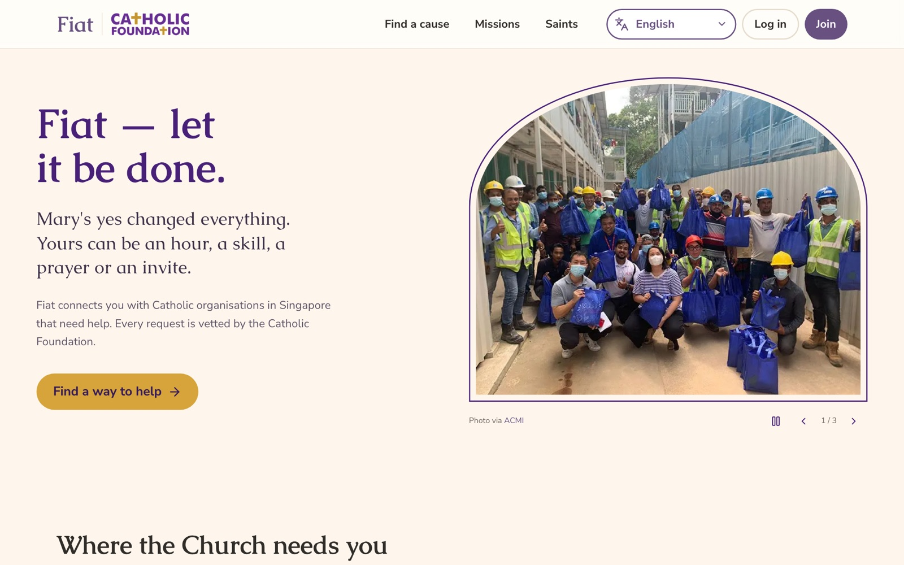
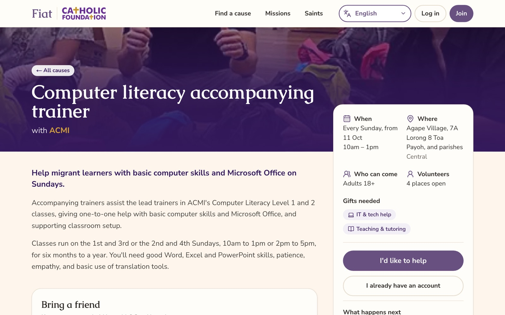
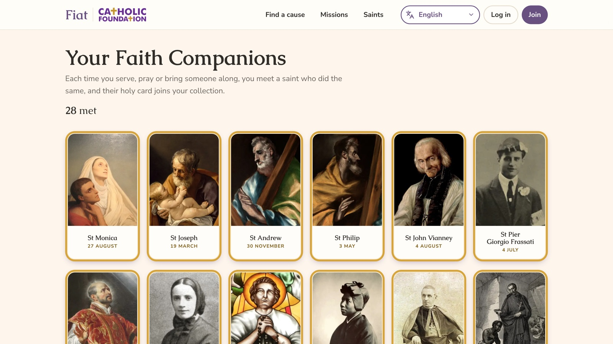
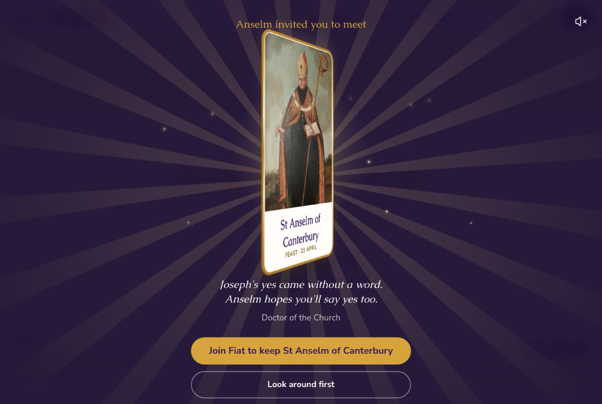

# Fiat — *Fiat voluntas tua*

> Mary's yes changed everything. Yours can be an hour, a skill, a prayer or an invite.

Fiat connects Catholics in Singapore with Catholic organisations that need help. Every organisation and request is vetted by the **Catholic Foundation (Singapore)**. Built for the **FIAT Catholic Hackathon 2026**.

Not everyone can give money. Everyone can give something: their time, their skills, their prayer.

**Live:** https://fiat.anselmlong.com



## What it does

- **Supporters** sign up with their gifts (skills), see the causes that need them, offer to help, pray for causes
  they can't attend, check in at the venue with a QR code, and follow the impact on "My impact".
- **Organisations** register (vetted by CF), post one-off or weekly volunteer requests, see who offered (with
  contact details and matching skills), accept or decline, post updates and mark requests complete with outcomes.
- **Catholic Foundation** approves, rejects or asks for changes on every organisation and every request.
- **Missions** offer small steps of faith: bring a friend to Mass, take a day to pause and listen, learn the faith foundations.
- Available in **English, Bahasa Melayu and Tamil**.



## Your Faith Companions

Each time you serve, pray or bring someone along, you meet a saint who did the same, and their holy card joins
your collection. Praying for a cause brings St Monica; inviting a friend brings St Andrew.

- **28 saints** in the main collection, each with a short story, a sourced quote and a one-line prayer.
- **4 bonus cards** hidden around the site for curious people.
- **The reveal:** the card arrives face down, gathers light and turns over. Once turned, it leans toward your cursor,
  and you can drag and flick it to spin it in 3D while gold foil light follows its angle. It uses CSS 3D transforms
  and a small spring loop, with no WebGL. With reduced motion turned on, it stays still.




## Demo logins (after `npm run seed`)

| Role | Email | Password |
| --- | --- | --- |
| Catholic Foundation admin | cf@fiat.sg | fiat-cf-2026 |
| Catholic Welfare Services | cws@fiat.sg | fiat-org-2026 |
| ACMI | acmi@fiat.sg | fiat-org-2026 |
| Caritas Singapore | caritas@fiat.sg | fiat-org-2026 |
| Office for Young People | oyp@fiat.sg | fiat-org-2026 |
| Catholic Prayer Society (pending review) | cps@fiat.sg | fiat-org-2026 |
| Volunteer (3 saints met) | maria@fiat.sg | fiat-2026 |
| Volunteer (every saint unlocked) | saints@fiat.sg | fiat-2026 |

New supporter accounts are created live through **Join**.

## Stack

Next.js 16 (App Router, server actions) · React 19 · TypeScript · Tailwind CSS v4 · Neon Postgres + Drizzle ORM ·
cookie sessions (jose + bcrypt) · deployed on Vercel.

```bash
vercel env pull .env.local   # DATABASE_URL, SESSION_SECRET
npm install
npm run db:push              # create tables
npm run seed                 # reset to the demo data (safe to re-run)
npm run dev
```

## Project layout

| Path | What's there |
| --- | --- |
| `src/app/causes`, `src/app/orgs` | Finding causes, offering help, praying, QR check-in |
| `src/app/org`, `src/app/admin` | Organisation dashboard and Catholic Foundation review |
| `src/app/faith`, `src/app/missions`, `src/app/saints` | The saint collection, missions and saint stories |
| `src/components/saint-reveal.tsx` | The card reveal and the hand-held 3D card |
| `src/lib/saint-roster.ts`, `src/lib/bonus-saints.ts` | Every saint: story, quote, prayer and image credit |
| `src/db/schema.ts` | Database schema |
| `scripts/seed.ts` | Demo data |

## Credits

Organisation names, descriptions and photos come from each organisation's public website. Saint portraits are
public-domain or openly licensed works from Wikimedia Commons, and every image and story source is listed in
[`SOURCES.md`](SOURCES.md). Requests, stories and outcome numbers in the seed are sample content.
